# ROS2 Autonomous Logistics AMR

An autonomous mobile robot (AMR) for warehouse logistics applications built with ROS2 Jazzy, Gazebo Harmonic, and Nav2. The robot autonomously navigates a warehouse environment using SLAM-generated maps and AMCL localization.

---

## Architecture Overview

<p align="center">
  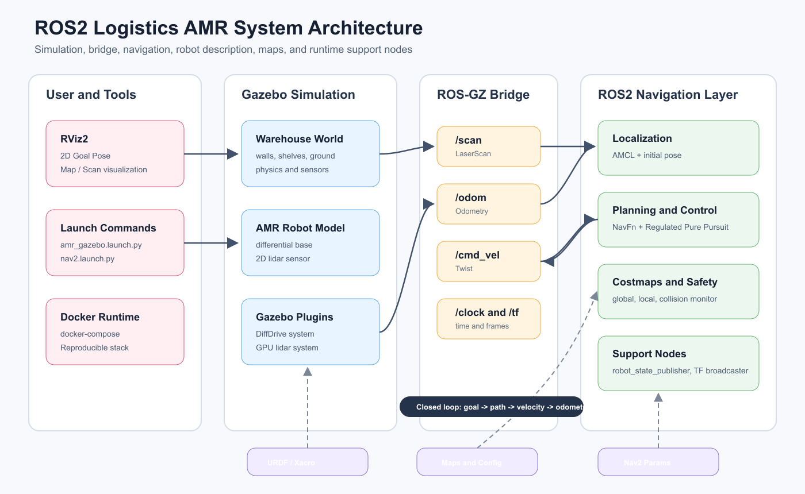
</p>

<p align="center">
  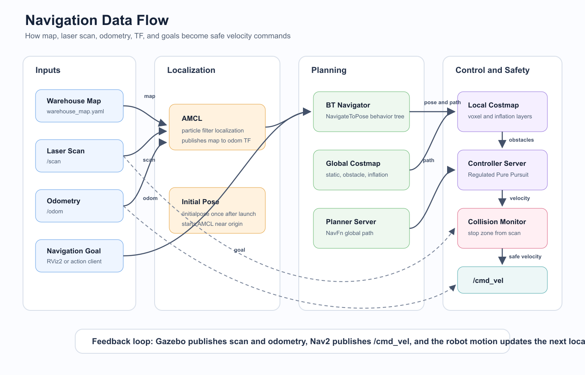
</p>

<p align="center">
  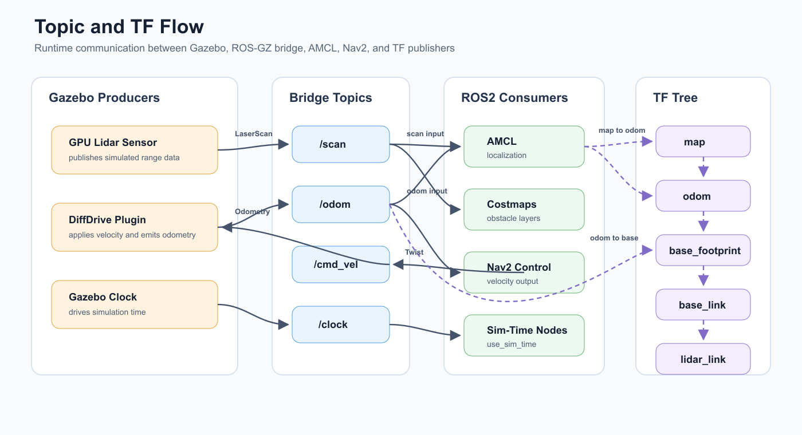
</p>

---


## Features

- **Autonomous Navigation** — Nav2 stack with AMCL localization and NavFn global planner
- **SLAM Mapping** — Real-time warehouse map generation using SLAM Toolbox
- **Sim-to-Real Ready** — Full ROS2 Jazzy + Gazebo Harmonic pipeline with ros2_control hardware interfaces
- **Containerised** — Complete Docker stack for reproducible deployment
- **CI/CD** — GitHub Actions pipeline that builds and tests on every push
- **Warehouse World** — Custom Gazebo SDF environment with walls and shelf obstacles

---

## Stack

| Component | Technology |
|-----------|-----------|
| Robot OS | ROS2 Jazzy |
| Simulation | Gazebo Harmonic 8.x |
| Navigation | Nav2 (AMCL + NavFn + RegPP Controller) |
| SLAM | SLAM Toolbox |
| Hardware Interface | ros2_control + diff_drive |
| Containerisation | Docker + docker-compose |
| CI/CD | GitHub Actions |
| Language | Python, C++ |

---

## Quick Start

### Prerequisites
- Ubuntu 24.04
- ROS2 Jazzy
- Gazebo Harmonic
- Docker (optional)

### Install dependencies

```bash
sudo apt install -y \
  ros-jazzy-navigation2 \
  ros-jazzy-nav2-bringup \
  ros-jazzy-slam-toolbox \
  ros-jazzy-ros-gz \
  ros-jazzy-rmw-cyclonedds-cpp \
  python3-colcon-common-extensions
```

### Build

```bash
git clone https://github.com/DAI-Qian/ros2_logistics_amr.git
cd ros2_logistics_amr
colcon build --symlink-install
source install/setup.bash
```

### Run

**Terminal 1 — Gazebo simulation:**
```bash
ros2 launch amr_bringup amr_gazebo.launch.py
```

**Terminal 2 — Nav2 autonomous navigation:**
```bash
ros2 launch amr_bringup nav2.launch.py
```

**Terminal 3 — RViz visualisation:**
```bash
ros2 run rviz2 rviz2
```

Set Fixed Frame to `map`, add `/map` and `/scan` topics, then use **2D Goal Pose** to send navigation goals.

### Docker

```bash
cd docker
docker-compose up
```

---

## How It Works

1. **Robot spawns** in a Gazebo warehouse world with walls and shelves
2. **SLAM Toolbox** builds a 2D occupancy map as the robot explores
3. **AMCL** localises the robot on the saved map using lidar scan matching
4. **Nav2** plans a collision-free path and executes it using the Regulated Pure Pursuit controller
5. **ros2_control** sends velocity commands to the differential drive plugin

---

## 系统架构图

下面的图基于当前仓库中的 launch 文件、URDF/Xacro、Nav2 参数、Gazebo world、地图文件和 `amr_controller` 节点整理。
### 1. 软件包与文件组织

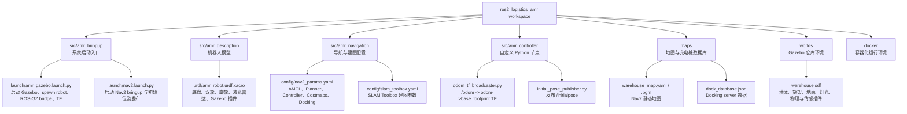

### 2. 运行时总体架构

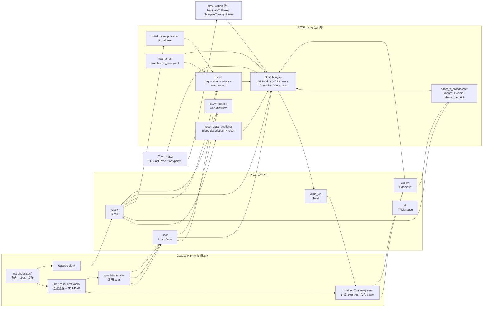

### 3. Nav2 导航数据流

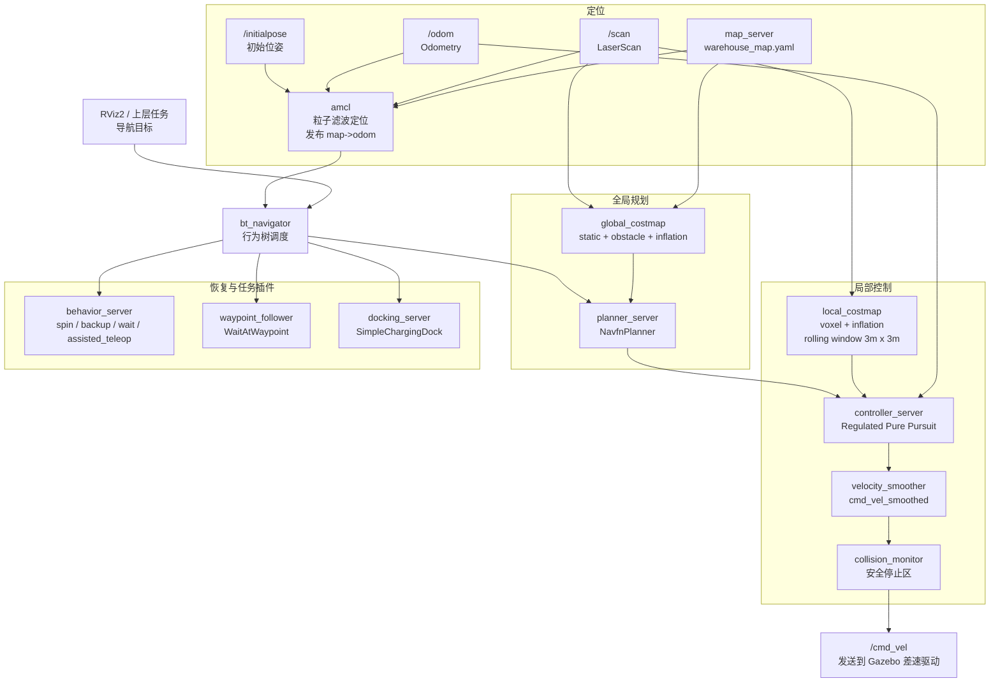

### 4. Topic 与 TF 关系

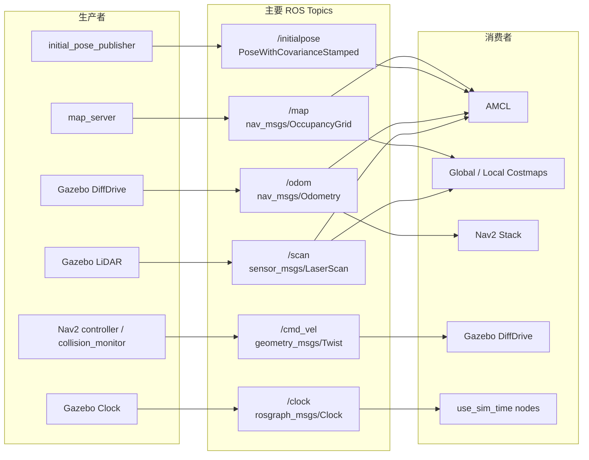

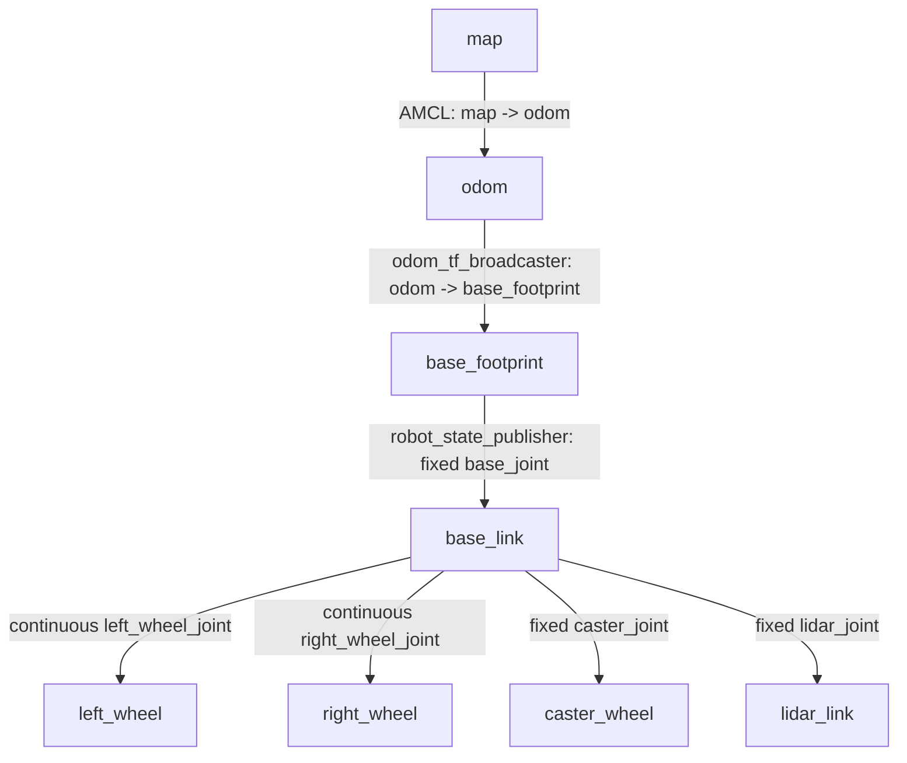

### 5. 启动时序

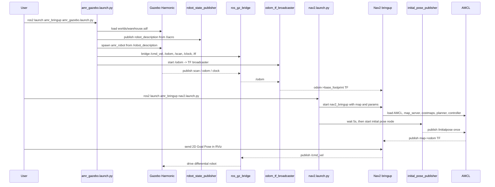

### 6. 仿真机器人与物理环境

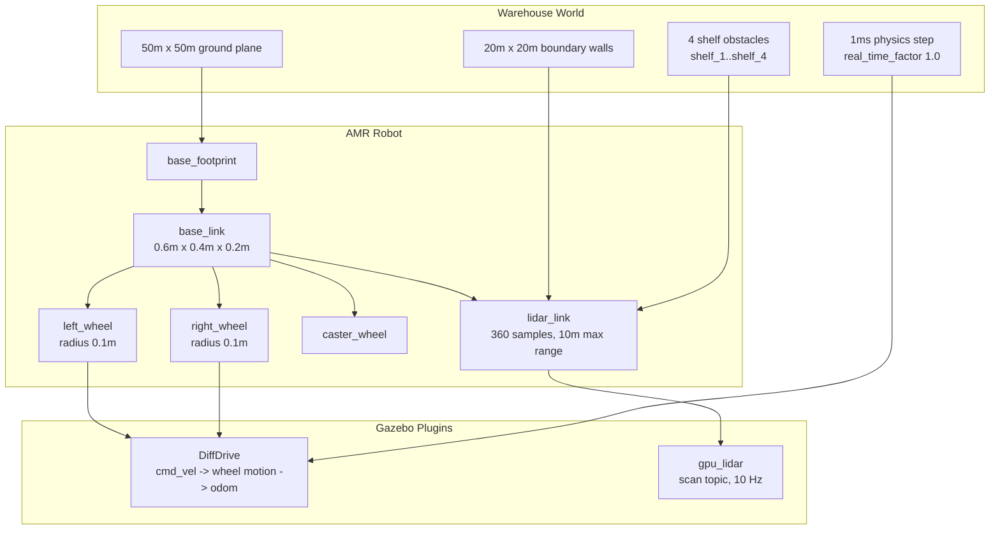

### 7. 在线建图与离线导航流程

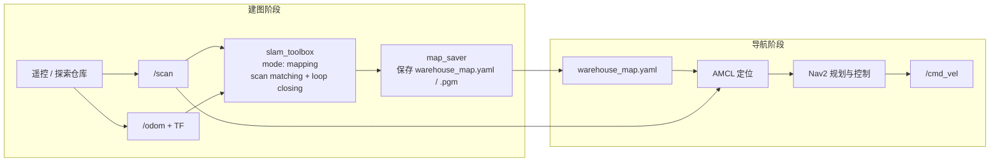
